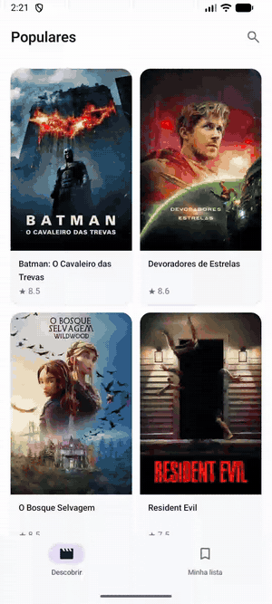
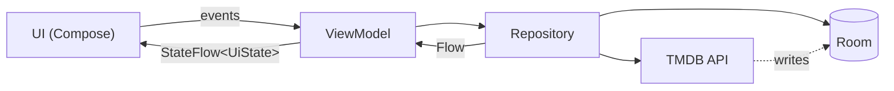

# Cinélog

[](https://github.com/GabrielOliveiraTh/cinelog/actions/workflows/ci.yml)

<p align="center">
  
</p>

Cinélog is a movie discovery app for Android, built with Kotlin and Jetpack Compose on top of the
[TMDB](https://www.themoviedb.org/) API. Browse popular movies, search, read details and keep a
personal watchlist, all of it working offline.

**This is a study project.** The goal is not the product itself, but to practice a production-grade
architecture: offline-first data, unidirectional data flow, modularization and a solid quality
pipeline. It follows the official Android architecture guidance and
[Now in Android](https://github.com/android/nowinandroid).

## Features

- **Discover:** popular movies with infinite scroll, pull to refresh and offline cache.
- **Search:** results as you type.
- **Details:** overview, genres, runtime, rating and cast.
- **Watchlist:** to watch and watched, with undo on remove.
- **Release alerts:** a background sync notifies you when a movie on your list is released.

## Tech stack

Jetpack Compose and Material 3, Navigation 3, Hilt, Coroutines and Flow, Room, Paging 3 with
`RemoteMediator`, Retrofit, OkHttp, kotlinx.serialization, Coil 3, WorkManager. Gradle Kotlin DSL
with a version catalog and convention plugins. ktlint, Detekt, Android Lint and GitHub Actions for
quality.

## Architecture



- **Offline-first:** the UI only observes Room; the network only writes to the database.
- **Unidirectional data flow:** each ViewModel exposes a single `StateFlow` with the screen state.
- **Separate models per layer:** DTO, Room entity and domain model are distinct classes.
- **Modular:** each feature is split into `api` (navigation key) and `impl` (screens and
  ViewModels). Features never depend on each other; the `app` module wires navigation between them.

## Running

1. Create a [TMDB](https://www.themoviedb.org/signup) account and copy the **API Read Access Token**.
2. Add it to `local.properties` at the project root:

   ```properties
   tmdb.accessToken=YOUR_TOKEN
   ```

3. Open the project in Android Studio and run the app.

## Checks

```bash
./gradlew testDebugUnitTest
./gradlew spotlessCheck detekt lintDebug
```

---

This product uses the TMDB API but is not endorsed or certified by TMDB.
